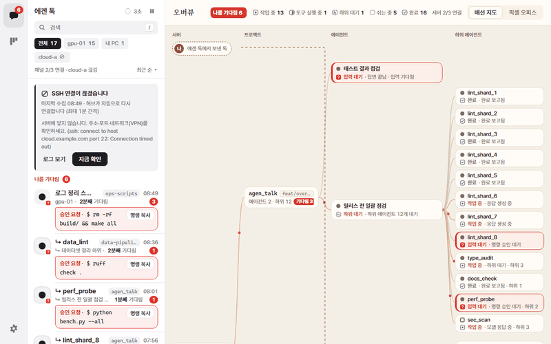
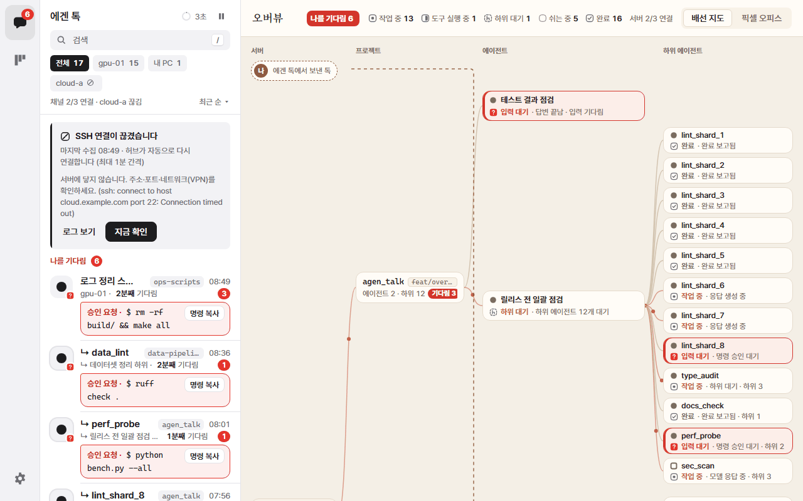
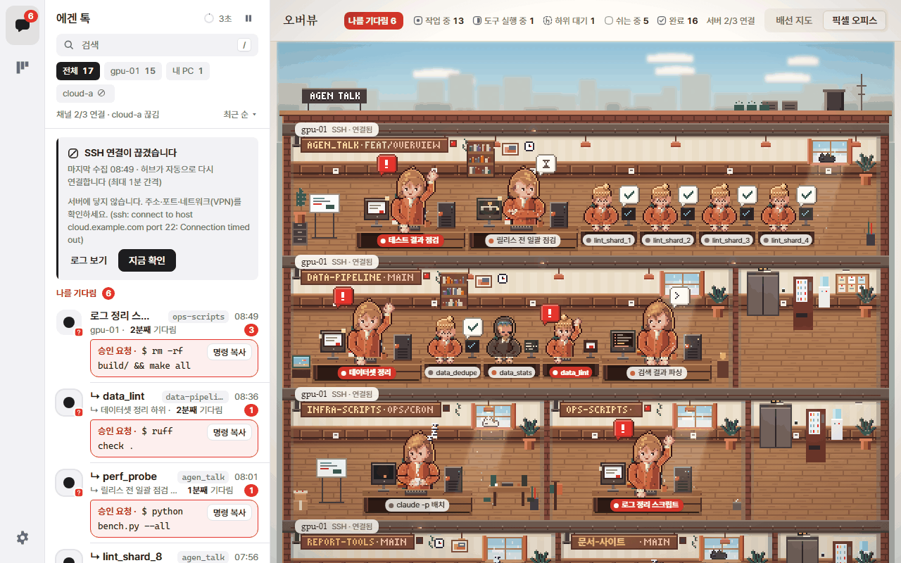
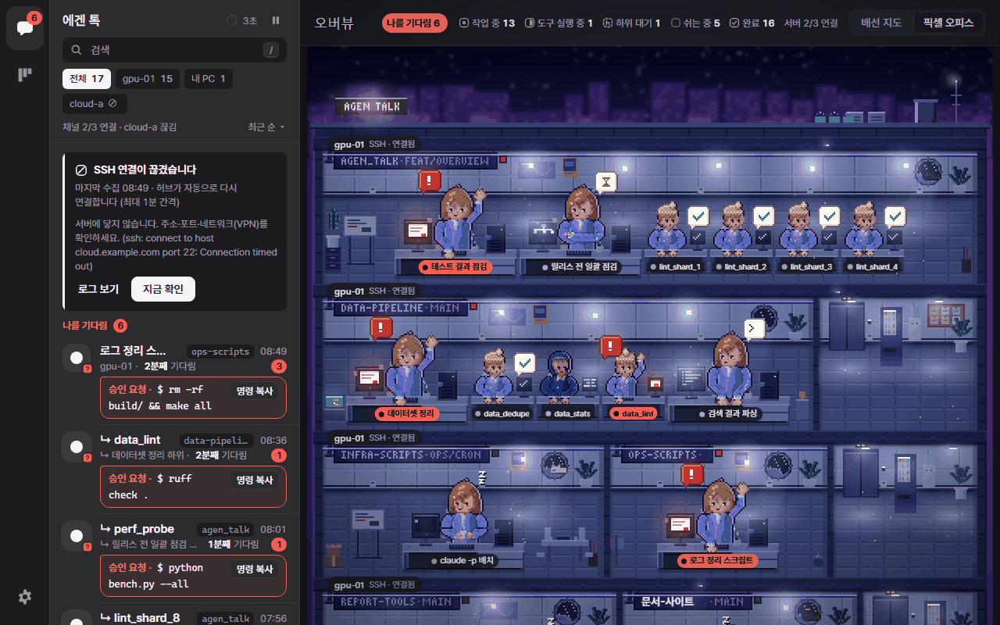
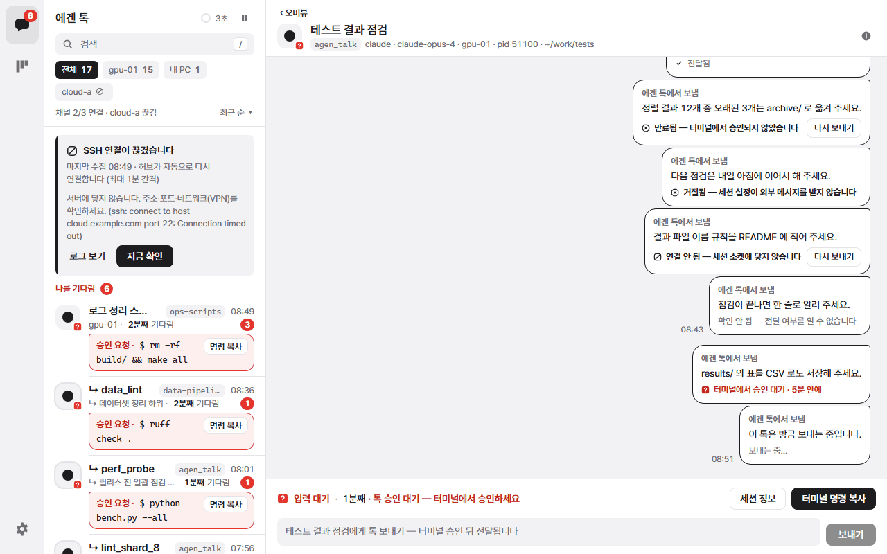
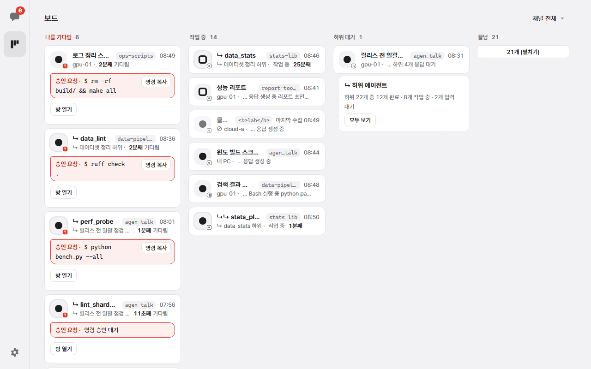
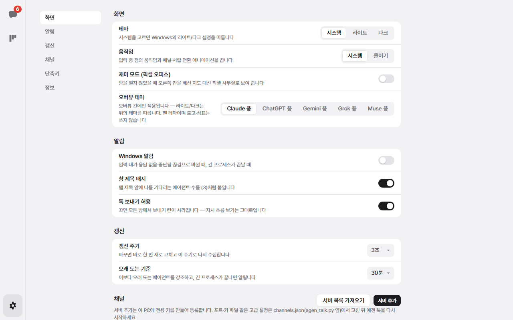

# 에겐 톡 · Agen Talk

[](https://github.com/Ben-JWL/agen_talk/actions/workflows/ci.yml)
[](https://github.com/Ben-JWL/agen_talk/releases/latest)
[](https://github.com/Ben-JWL/agen_talk/releases)

[](LICENSE)

**English** · [한국어](README.ko.md)

**All the AI coding agents you are running — Claude Code, Codex, Antigravity — in one window, like a chat app.**

## See it in action



<sub>Sample data. The app's interface is in Korean; [What the buttons mean](#what-the-buttons-mean) has the translations.</sub>

## Install

- **Windows installer (recommended):** download `AgenTalk-Setup-<version>.exe` from the [latest release](https://github.com/Ben-JWL/agen_talk/releases/latest) and run it.
  - No admin rights needed: it installs for your user only.
  - The installer is not code-signed yet, so Windows may say *"Windows protected your PC"*. Click **More info → Run anyway**. See [Code signing policy](#code-signing-policy).
  - To update, run the new installer over the old one. Your servers and settings are kept.
- **Portable:** download `AgenTalk-<version>-portable.zip`, unzip it anywhere and run `AgenTalk.exe`.
- **From source** (Python 3.8+, any OS for the collector, Windows for the app window): see [Development](#development).

Windows 10 or 11 (64-bit) with Microsoft Edge WebView2, which current Windows versions already have. To watch a server you only need SSH access and `python3` 3.8+ there. Nothing gets installed on the server.

## Features

- **One room per agent.** Every Claude Code, Codex and Antigravity session on your PC and on your SSH servers shows up on its own. Each room says what the agent is for, what it is doing right now, and whether it is really working.
- **Needs me, on top.** Approval requests, questions and stalled agents get a red badge and a Windows notification. A button copies the command an agent is waiting to run.
- **Overview.** When no room is open, a wiring map shows every server → project → agent → subagent, live.
- **Pixel office (fun mode).** Optional: the overview becomes an animated pixel-art office, one room per project, with five fan themes (Claude, ChatGPT, Gemini, Grok, Muse style) in light and dark.
- **Projects.** Agents are grouped by the git repository they work in, read from the repo's files, so the same repo groups together across machines.
- **Who told whom.** Instructions from a main agent to its subagents, and their reports, appear as cards and as a flow tree.
- **Talk.** You can send a short message into a running Claude Code or Codex session on a Linux server.
- **Tidy up.** Hide finished rooms in one click; they come back by themselves if the session wakes up.
- **Private by design.** No account, no cloud, no telemetry. Data moves only over your own SSH connections.

## Screenshots

| | |
|---|---|
| [](docs/img/overview.png) **Overview**: server → project → agent | [](docs/img/office.png) **Pixel office**: fun mode, Claude style |
| [](docs/img/office-dark.png) **Pixel office**: Gemini style, dark | [](docs/img/room.png) **A room** with sent talks and their delivery state |
| [](docs/img/board.png) **Board**: needs me, working, waiting, done | [](docs/img/settings.png) **Settings**: theme, fun mode, notifications, servers |

## Getting started

1. **See your agents.** Start your agents as usual and open **에겐 톡 (Agen Talk)** from the Start menu. Agents on this PC appear right away; the ones that need you are listed first under **나를 기다림** (needs me).
2. **Add a Linux server (optional).** Click the **gear** (Settings), then **서버 추가** (Add server). Enter the address, your account and password.
   - The first time, the app shows the server's *fingerprint*, a short code that identifies that machine. Compare it with the one from your administrator if you have it.
   - The app then installs its own key, forgets the password and connects without asking from then on.
   - If the server refuses key login, choose the session password option: it stays in memory until the app closes.
   - Got a server list from a teammate? Use **서버 목록 가져오기** (Import server list) with their `presets.json`, which looks like `{"presets": [{"name": "GPU box", "host": "gpu.example.com", "port": 22}]}`.
3. **Notifications.** Settings → **Windows 알림** → on.
4. **Overview and fun mode.** Close a room (**‹ 오버뷰** or Esc) to see the overview. Switch between **배선 지도** (wiring map) and **픽셀 오피스** (pixel office) at the top right; Settings → 화면 has **재미 모드** (fun mode) and **오버뷰 테마** (overview theme).
5. **Tidy up.** At the bottom of the list, **완료된 방 N개 정리** hides every finished room. **숨긴 방 N개 다시 보기** brings them back.
6. **Talk (optional).** In the room of a Claude Code or Codex session on a Linux server, type a message and press **Enter** twice: once to confirm, once to send.
   - The agent receives it as a message *from another session* and can never approve a prompt with it.
   - Sessions on the Windows PC itself, subagents and Antigravity cannot receive talks yet; the room says why.

## What the buttons mean

| Korean | Meaning |
|---|---|
| 오버뷰 · 배선 지도 · 픽셀 오피스 | Overview · wiring map · pixel office |
| 재미 모드 · 오버뷰 테마 | Fun mode · overview theme |
| 나를 기다림 | Needs me (approval, question or input) |
| 승인 요청 · 명령 복사 | Approval request · copy the command |
| 작업 중 / 진행 중 | Working |
| 응답 없음 / 조용함 | Stalled / quiet for a while |
| 하위 대기 · 하위 에이전트 | Waiting on subagents · subagent |
| 끝남 / 완료 | Done |
| 중단됨 / 끊김 | Stopped / disconnected |
| 프로젝트 · 기타 | Project · other (no git repository) |
| 완료된 방 N개 정리 · 숨긴 방 N개 다시 보기 · 목록에서 숨기기 | Tidy N finished rooms · show N hidden rooms · hide this room |
| 보드 · 설정 | Board · Settings |
| 서버 추가 · 서버 목록 가져오기 · 연결하기 | Add server · import server list · connect |
| 내 PC · 채널 | This PC · a connected machine |
| 톡 · 보내기 · 전달됨 | Talk · send · delivered |
| 흐름 · 세션 정보 · 터미널 명령 복사 | Flow · session info · copy the command to open its terminal |

Keyboard: **↑/↓** move between rooms, **Enter** opens, **Esc** goes back, **b** board, **,** settings, **r** refresh, **?** all shortcuts.

## Troubleshooting

- **An agent doesn't show up.** It must run under your Windows user, or under the same account on a server you added. Quiet rooms are collapsed under **N개 더 보기** (show N more); hidden ones under **숨긴 방 다시 보기**.
- **"SSH 연결이 끊겼습니다" (SSH disconnected).** Check the address, port and VPN. The card shows the SSH error; **지금 확인** (Check now) retries at once, and the app retries by itself at most once a minute.
- **"서버에 python3 가 없습니다" (no python3).** Ask for Python 3.8+ on the server. If it is named differently (for example `python3.11`), set the server's `python` field in `%APPDATA%\AgenTalk\channels.json`.
- **It opened in Chrome/Edge instead of its own window.** WebView2 is missing: install the *Evergreen Runtime* from Microsoft and start the app again.
- **Projects show as 기타 (other).** The agent was started in a folder that is not inside a git repository.
- **Logs** are in `%LOCALAPPDATA%\AgenTalk\agen-talk.log` (Settings → 정보 shows the folder).

## Development

```bash
git clone https://github.com/Ben-JWL/agen_talk.git && cd agen_talk
pip install pywebview paramiko     # optional: without them a Chrome/Edge window and OpenSSH are used
python app.py                      # the desktop app
python agen_talk.py                # one-shot text view of your agents (--board, --json); stdlib only
python agen_talk.py --selftest && python app.py --selftest
python tools/check_ui.py           # ui/src must match index.html; rebuild with: python ui/build.py
python art/sprites/build.py        # pixel-art sources -> ui/src/72-sprites.js
```

[Architecture](docs/ARCHITECTURE.md) · [Overview contract](docs/OVERVIEW-CONTRACT.md) · [Pixel art](art/sprites/README.md) · [Third-party notices](THIRD_PARTY_NOTICES.md)

Releases are built by GitHub Actions when a `v*` tag is pushed (`.github/workflows/release.yml`).

## Code signing policy

The Windows installer and executable are **not code-signed yet**, which is why SmartScreen warns. Instead:

- Every release is built from this repository by GitHub Actions, never on a personal machine. The build log is public.
- Each release ships `SHA256SUMS`. Check a download with `certutil -hashfile AgenTalk-Setup-<version>.exe SHA256`.
- Each file carries a signed build-provenance attestation. With the GitHub CLI, run `gh attestation verify AgenTalk-Setup-<version>.exe --repo Ben-JWL/agen_talk`; it proves the file was built by this repository's workflow.
- Build dependencies are pinned by hash (`packaging/requirements-build.lock`) and all workflow actions are pinned to commit SHAs.

The project will sign releases when a code-signing certificate is available.

### Privacy policy

- **No telemetry, no account, no cloud.** The app does not send anything anywhere except over SSH to servers you add yourself.
- **Local only.** The dashboard listens on `127.0.0.1` under a random path that changes every launch. The first page load starts a session cookie, so a copied URL is useless. Changing requests also need a per-launch token. Do not run `agen_talk.py hub --insecure` on a shared machine: in that mode every local account can read your agents' text.
- **Passwords are never stored.** The server password is used once to register the app's key. The session password option keeps it in memory until the app closes.
- **Your key.** The app's SSH key is kept unencrypted in `%APPDATA%\AgenTalk\id_ed25519`, readable only by your Windows user. On servers it is installed with `no-port-forwarding,no-agent-forwarding,no-X11-forwarding,no-pty`. Uninstalling does not remove it: delete the line ending in `agen-talk@<your PC name>` from each server's `~/.ssh/authorized_keys` when you stop using the app.
- **What stays on your PC.** For about 24 hours the window caches room contents so they survive a restart: agents' instructions, reports, activity lines including commands, and the talks you sent. They are kept in `%LOCALAPPDATA%\AgenTalk\webview`, unencrypted. Common secret patterns (API keys, tokens, private keys, passwords in URLs or `password=` values) are masked as `[가려짐]` in agent text, but masking is pattern-based and cannot catch everything.
- **Full removal.** Uninstall from Windows Settings → Apps, then delete `%APPDATA%\AgenTalk` and `%LOCALAPPDATA%\AgenTalk`.

Found a security problem? Please report it privately through the repository's [Security](https://github.com/Ben-JWL/agen_talk/security) tab instead of a public issue.

## Credits

Pixel art (characters, office, animation) was made for this project by Claude Opus 5.5 with GPT-6.1-sol and gpt-6-astra passes. Sea of Stars, Eastward and the Octopath Traveler series were style references only; no assets were used. The fan themes borrow colours and moods from AI products; they use no logos or trademarks and are not affiliated with or endorsed by those companies.

## License

[MIT](LICENSE).
